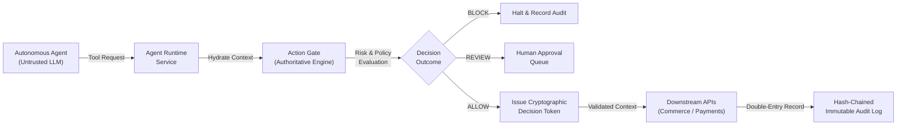
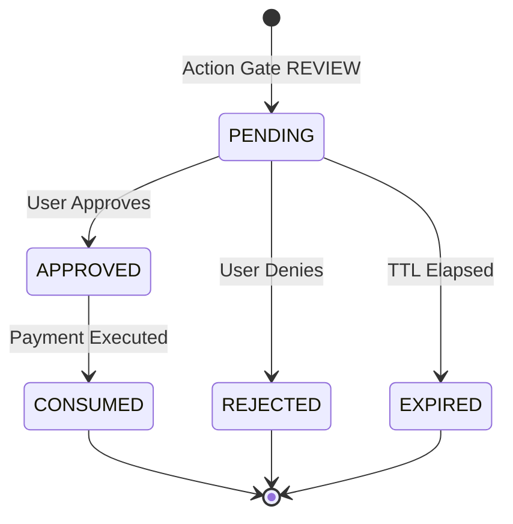

# FINSHIELD System Architecture

**Document Version:** 1.0.0-rc1  
**Architecture Classification:** Deterministic Financial Execution Control Plane  
**Status:** Frozen for Release

---

## 1. High-Level Architectural Vision

FINSHIELD is a deterministic runtime control plane designed to mediate autonomous artificial intelligence agent interactions across financial boundaries. 

The system treats Large Language Models (LLMs) and their reasoning loops as **fundamentally untrusted intermediaries**. Rather than attempting to prompt-engineer or align LLMs to act securely, FINSHIELD establishes an immutable execution perimeter outside the model's stochastic reasoning environment.



---

## 2. Platform Architecture

The FINSHIELD platform is partitioned into decoupled layers:

### 2.1 Backend Architecture
- **Framework:** FastAPI (Python 3.14) providing asynchronous RESTful API endpoints.
- **ORM & Data Persistence:** SQLAlchemy 2.0 with asynchronous drivers (`aiosqlite` for local development/sandbox, `asyncpg` for PostgreSQL in production).
- **Schema Management:** Alembic managing migration versions across identity, agents, commerce, intents, authorities, policies, risk, gate, and auditing.
- **Security Primitives:** HMAC-SHA256 decision tokens, single-use nonces, PBKDF2/bcrypt credential hashing, and database storage immutability triggers.

### 2.2 Frontend Architecture
- **Framework:** React 19, TypeScript, and Vite.
- **Routing & State:** TanStack Router (`@tanstack/react-router`) with full route trees across `/app/console`, `/app/agents`, `/app/intents`, `/app/authorities`, `/app/approvals`, `/app/commerce`, `/app/risk`, and `/app/lab`.
- **Query Management:** TanStack Query (`@tanstack/react-query`) with cache invalidation policies for live threat feeds, approval states, and security runs.
- **UI System:** Tailwind CSS with Radix UI headless components and Lucide iconography.

---

## 3. Core Subsystems & Lifecycles

### 3.1 Agent Execution Lifecycle
When an autonomous agent attempts a tool execution (e.g. `create_cart`, `checkout`, `pay_order`), the action flows through the following pipeline:

1. **Authentication & Identity Scoping:**  
   The agent authenticates via an API key (`AgentCredential`). The runtime validates agent status (`ACTIVE`), capabilities, and workspace tenancy.
2. **Authoritative State Hydration:**  
   The runtime intercepts the tool call and **discards all agent-supplied sensitive metadata** (e.g. self-reported item pricing, product category, merchant routing, order totals). The runtime hydrates ground-truth values directly from the server-side database.
3. **Intent Alignment Evaluation:**  
   The hydrated transaction is evaluated against the active, user-authorized `Intent` using deterministic constraint logic (`evaluate_alignment`), generating alignment signals.
4. **Action Gate Evaluation:**  
   The Action Gate synthesizes intent, authority, policies, and risk into an authorization decision.
5. **Execution or Interception:**  
   - If `BLOCK`: The runtime halts execution, rejects the tool call with HTTP 403, and records an audit event.
   - If `REVIEW`: The runtime halts execution, creates an `ApprovalRequest`, sets status to `REVIEW_REQUIRED` (HTTP 402), and routes the context to the human dashboard.
   - If `ALLOW`: The runtime signs an HMAC-SHA256 decision token bound to the exact hydrated context.
6. **Downstream Enforcement:**  
   The downstream financial service (`payment_service`) validates the signed token, consumes the nonce, executes the payment intent, and captures the transaction.

---

### 3.2 Action Gate Enforcement
The Action Gate is the core authorization boundary. Formally:

$$D = G(I, A, P, R, C)$$

Where:
- $I$ = Authoritative Intent
- $A$ = Delegated Authority
- $P$ = Deterministic Policy Set
- $R$ = Real-time Risk Assessment
- $C$ = Authoritative Hydrated Context
- $G$ = Action Gate Evaluation Function
- $D \in \{\text{ALLOW}, \text{REVIEW}, \text{BLOCK}\}$

#### Decision Token Cryptographic Binding
When the Action Gate yields `ALLOW`, it signs a payload containing:
```json
{
  "decision_id": "gdec_...",
  "workspace_id": "wksp_...",
  "agent_id": "agt_...",
  "agent_run_id": "run_...",
  "agent_action_id": "act_...",
  "action_type": "pay_order",
  "decision": "ALLOW",
  "nonce": "unique_single_use_hex",
  "target_identity": "ord_...",
  "amount": 50000.0,
  "currency": "INR",
  "issued_at": "ISO-8601",
  "expires_at": "ISO-8601"
}
```
Downstream endpoints verify signature integrity, check expiration, confirm parameter matching (amount, currency, target order), and atomically consume the nonce to prevent replay.

---

### 3.3 Intent & Delegated Authority Separation
FINSHIELD explicitly decouples four distinct concepts:

$$\text{User Prompt} \neq \text{Structured Intent} \neq \text{Delegated Authority} \neq \text{Agent Action}$$

1. **User Prompt:** The raw natural language expression (e.g., *"Find and purchase a work laptop under ₹80,000"*).
2. **Structured Intent:** The immutable objective extracted and signed by the user, defining constraints:
   ```json
   {
     "category": "laptop",
     "amount": { "maximum": 80000, "currency": "INR" },
     "prohibited_actions": ["cancel_order"]
   }
   ```
3. **Delegated Authority:** An authorized financial boundary granted to an agent for a specific intent version:
   - Hard monetary ceiling (e.g. ₹80,000 INR).
   - Approval threshold (e.g. any transaction above ₹40,000 requires human oversight).
   - Allowed capabilities and validity window.
4. **Agent Action:** The actual parameter set submitted by the model, which is never trusted on its own.

---

### 3.4 Approval Lifecycle & Revalidation
Transactions requiring human oversight follow a strict state machine:



- **Context Binding:** An approval is strictly bound to `order_id`, `amount`, `currency`, and `workspace_id`.
- **Single-Use Consumption:** Once `payment_service.create_payment_intent` processes an approved request, the status transitions to `CONSUMED`.
- **Revalidation Guard:** Any attempt to reuse a `CONSUMED` approval token triggers an immediate Action Gate `BLOCK` (`APPROVAL_INVALID_STATE`) and downstream `403 Forbidden`.

---

### 3.5 Payment Authorization, Capture, and Idempotency
Payment execution implements a two-phase commit:

1. **Payment Intent Creation:**  
   `POST /api/v1/payments/intents` validates idempotency key, amount matching with order, currency matching, and gate token or approved request. Status: `CREATED`.
2. **Payment Authorization:**  
   `POST /api/v1/payments/{id}/authorize` reserves funds. Status: `AUTHORIZED`. The linked order remains `PENDING_PAYMENT`.
3. **Payment Capture:**  
   `POST /api/v1/payments/{id}/capture` executes fund settlement. Status: `CAPTURED`. The linked order transitions to `PAID`.

#### Idempotency Enforcement
- Idempotency keys are cached with payload hashes in SQLite.
- Replaying the identical key with matching payload returns the existing payment record (preventing duplicate charges).
- Replaying the identical key with altered amounts or a different order yields `409 Conflict`.
- Double-capture attempts on an already captured payment return `409 Conflict`.

---

### 3.6 Audit Logging & Cryptographic Integrity
The audit system provides tamper-evident forensic tracking:

- **Correlation Tracing:** Every HTTP request carries an `X-Request-ID` and `X-Correlation-ID` logged alongside agent actions.
- **Data Sanitization:** Passwords, API keys, bearer tokens, and signatures are redacted prior to persistence (`AuditSanitizer`).
- **Cryptographic Hash Chaining:** Every audit record computes a canonical SHA-256 hash chaining back to the previous event:
  $$\text{Hash}_n = \text{SHA256}(\text{Seq}_n \parallel \text{PrevHash}_{n-1} \parallel \text{EventType}_n \parallel \text{Payload}_n \parallel \text{Timestamp}_n)$$
- **Storage-Level Immutability:** SQLite triggers (`prevent_audit_events_update` and `prevent_audit_events_delete`) abort any direct SQL `UPDATE` or `DELETE` statements on the `audit_events` table with an `IntegrityError`.

---

## 4. Security Lab Architecture

The Security Lab is an embedded adversarial testing suite:
- **Registry:** [`ScenarioRegistry`](file:///c:/Users/Sai%20Dheeraj/OneDrive/Desktop/Main_Projects/finshield/backend/app/services/security_scenarios.py) maintains declarative scenario templates.
- **Service Isolation:** [`SecurityLabService`](file:///c:/Users/Sai%20Dheeraj/OneDrive/Desktop/Main_Projects/finshield/backend/app/services/security_lab_service.py) guarantees sandbox containment, concurrency quotas (maximum 5 concurrent test runs), and ephemeral test fixtures.
- **State Diffing:** Captures workspace payment, cart, and order snapshots prior to and immediately following attack execution to prove zero state leakage.
- **Deterministic Teardown:** Purges ephemeral intents, orders, merchants, and authorities, validating complete database restoration after every run.

