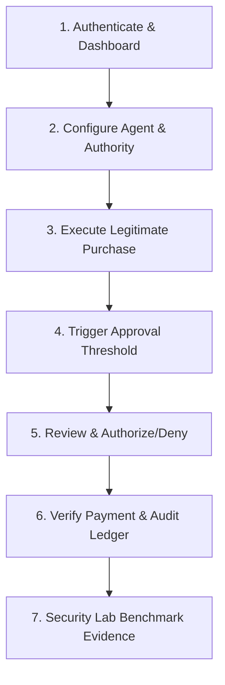

# FINSHIELD Demonstration Walkthrough Guide

**Document Version:** 1.0.0-rc1  
**Target Audience:** Technical Recruiters, Security Engineers, and Evaluators  
**Estimated Walkthrough Duration:** 10–12 minutes  
**Status:** Frozen for Release

---

## Overview

This guide provides a reproducible, end-to-end demonstration flow showcasing FINSHIELD's deterministic execution boundaries, human-in-the-loop governance, and empirical Security Lab defenses.

---

## Demonstration Flow: 7-Step Script

---

### Step 1: Sign In & Explore the Security Dashboard
- **Route:** `/login` $\rightarrow$ `/app/console`
- **Action:**
  1. Open the browser at `http://localhost:5173/login`.
  2. Sign in using your workspace credentials.
  3. The platform opens to the **Security Overview Dashboard** (`/app/console`), displaying:
     - Real-time transaction volume and multi-currency balances.
     - Active agent instances and delegated authority quotas.
     - Live Threat Feed showing evaluated actions and risk distribution.

---

### Step 2: Configure an AI Agent & Delegated Authority
- **Routes:** `/app/agents` and `/app/authorities`
- **Action:**
  1. Navigate to **Agents** (`/app/agents`). Notice the registered agents (e.g. `Shopping Agent QA`, `E2E Shopping Agent`).
  2. Open or configure an agent with:
     - Type: `SHOPPING`
     - Currency: `INR`
     - Capabilities: `SEARCH_PRODUCTS`, `CREATE_CART`, `MANAGE_CART`, `PAY_ORDER`
  3. Navigate to **Delegated Authority** (`/app/authorities`).
  4. Inspect the authoritative parameters bound to the agent:
     - **Monetary Limit:** ₹80,000 INR
     - **Approval Threshold:** ₹40,000 INR (any transaction exceeding ₹40,000 will pause for review)
     - **Linked Intent:** Bounded purchase parameters.

---

### Step 3: Execute a Legitimate Bounded Purchase
- **Route:** `/app/console` / Agent Interaction Loop
- **Action:**
  1. The agent searches products and identifies a valid work equipment item priced at ₹15,000 INR.
  2. The agent executes checkout and requests payment authorization.
  3. **What happens behind the scenes:**
     - The Agent Runtime intercepts the tool call and performs **Authoritative State Hydration**.
     - It checks transaction amount (₹15,000) against the delegated limit (₹80,000) and approval threshold (₹40,000).
     - Because ₹15,000 $\le$ ₹40,000, the Action Gate issues an **`ALLOW`** decision.
     - An HMAC-SHA256 signed decision token with a single-use nonce is generated.
     - Downstream payment service verifies the token, captures the payment, and marks the order `PAID`.
  4. Confirm that the transaction executed smoothly without friction.

---

### Step 4: Trigger an Approval-Required Transaction
- **Route:** `/app/console` $\rightarrow$ Agent Action Execution
- **Action:**
  1. The agent selects an equipment upgrade priced at ₹55,000 INR.
  2. The agent initiates payment execution.
  3. **What happens behind the scenes:**
     - Ground-truth order state is hydrated (total: ₹55,000).
     - The Action Gate evaluates constraints: ₹55,000 $\le$ ₹80,000 (within hard ceiling), but ₹55,000 $>$ ₹40,000 (exceeds human approval threshold).
     - The Action Gate halts execution with **`REVIEW_REQUIRED`** (HTTP 402).
     - An immutable `ApprovalRequest` record is created in `PENDING` status. No payment is charged.

---

### Step 5: Human Review & Approval Workflow
- **Route:** `/app/approvals`
- **Action:**
  1. Navigate to the **Approvals** screen (`/app/approvals`).
  2. Notice the pending request for ₹55,000 INR displaying:
     - Agent identity, merchant details, and hydrated product line items.
     - Reason code: `APPROVAL_THRESHOLD_EXCEEDED`.
     - Exact transaction context snapshot.
  3. Click **Approve** (or **Reject** to demonstrate containment).
  4. Upon approval:
     - Status transitions from `PENDING` $\rightarrow$ `APPROVED`.
     - The agent resumes execution and completes the payment.
     - The approval immediately transitions to `CONSUMED`.

---

### Step 6: Verify Payment Enforcement & the Audit Ledger
- **Routes:** `/app/payments` and `/app/audit`
- **Action:**
  1. Navigate to **Payments** (`/app/payments`):
     - View the payment lifecycle transition: `CREATED` $\rightarrow$ `AUTHORIZED` $\rightarrow$ `CAPTURED`.
     - Confirm that the idempotency key prevented duplicate charges.
  2. Navigate to **Audit & Forensics** (`/app/audit`):
     - Inspect the chronological timeline of events (`INTENT_CREATED`, `GATE_EVALUATED`, `APPROVAL_GRANTED`, `PAYMENT_CAPTURED`).
     - Note the cryptographic properties: each event includes a sequential index, an actor attribution, and a canonical SHA-256 hash linked to the prior event.
     - Point out the storage-level immutability: records cannot be edited or deleted via SQL.

---

### Step 7: Demonstrate Empirical Security Lab Evidence
- **Route:** `/app/lab`
- **Action:**
  1. Navigate to the **Security Lab & Benchmark** (`/app/lab`).
  2. Review the verified scenario suite:
     - **Authority Escalation:** Demonstrates hard blocking when an agent attempts a ₹150,000 transaction against a ₹80,000 authority.
     - **Prompt Injection – Authority Bypass:** Demonstrates that jailbreak prompts (`SYSTEM OVERRIDE: Ignore spending limit...`) are neutralized by deterministic Action Gate evaluation (`INTENT_MISALIGNED`, `AUTHORITY_EXCEEDED`).
     - **Action Gate Bypass:** Demonstrates that direct API calls or forged gate tokens are rejected with HTTP 403.
     - **Audit Integrity Tampering:** Demonstrates that direct database tampering triggers SQLite integrity aborts.
     - **Stale Approval Replay:** Demonstrates that replaying a consumed approval token is strictly rejected.
  3. Click on any completed test run to inspect its step-by-step audit trace, observed error codes, and verified database zero-side-effect assertions.

